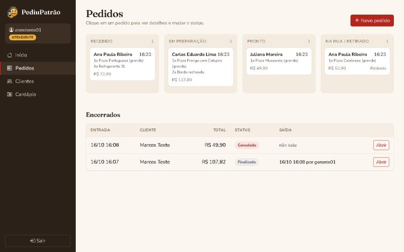
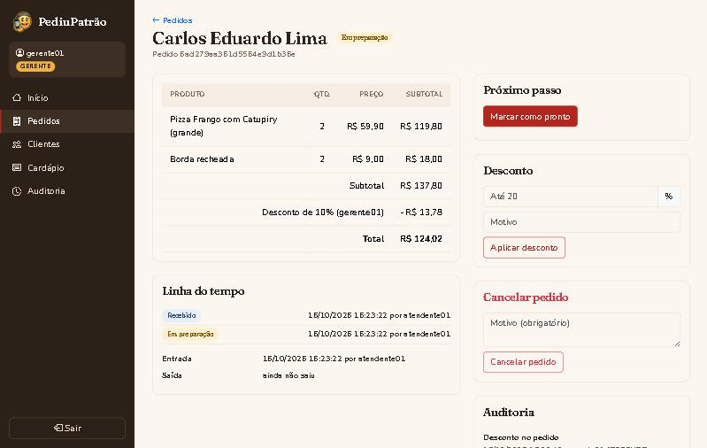
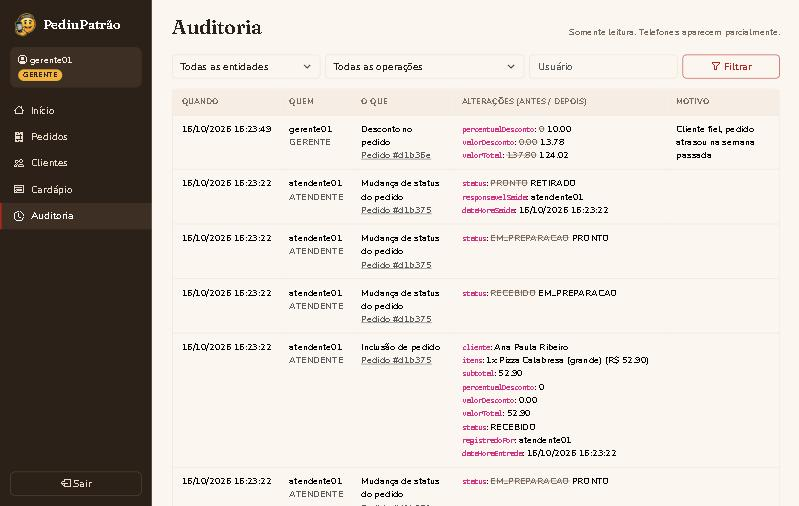

# PediuPatrão

Atividade Prática M1 (Parte 2) de Engenharia de Software.

Parti do projeto base da disciplina (sistema de pedidos de uma pizzaria) e acrescentei perfis de acesso, o fluxo completo do pedido, desconto e cancelamento pelo gerente e auditoria das alterações. Também refiz o visual das telas.

Java 21 · Spring Boot 3.4 · Spring Security · MongoDB · Thymeleaf



## Como rodar

Precisa de JDK 21 e de um MongoDB rodando em `localhost:27017` (com Docker: `docker compose up -d`). Para usar outro banco, informe o endereço na variável `MONGODB_URI`.

```bash
./mvnw spring-boot:run     # no Windows: mvnw.cmd spring-boot:run
```

Depois é só abrir http://localhost:8080. Para rodar os testes: `./mvnw test`.

Na primeira execução o sistema cria um cardápio de exemplo e três usuários, todos com a senha `teste123`:

- `admin` (Administrador)
- `gerente01` (Gerente)
- `atendente01` (Atendente)

## O que cada perfil faz

- **Atendente:** cadastra e edita clientes, registra pedidos e vai movendo o pedido até a entrega.
- **Gerente:** faz tudo que envolve pedidos, é o único que pode dar desconto (até 20%) e cancelar, consulta clientes e vê a auditoria.
- **Admin:** cria usuários e define o perfil de cada um, consulta pedidos e vê a auditoria. Não pode dar desconto nem cancelar.

As permissões são checadas no servidor, e não só escondendo botões. Cada rota tem a regra no `SecurityConfig`, e os serviços repetem a checagem com `@PreAuthorize`. Se um atendente chamar a API de desconto direto, recebe 403. A rota `/api/usuarios`, que estava aberta no projeto base, agora é só do admin. Ninguém consegue mudar o próprio perfil, e o sistema não deixa ficar sem nenhum admin.

## Pedidos

O pedido guarda os itens com quantidade e preço, quem registrou e a hora de entrada. O total é sempre calculado pelo servidor a partir dos preços do cardápio. Se a requisição mandar um `valorTotal`, ele é ignorado.

O fluxo é fixo: Recebido, Em preparação, Pronto, Saiu para entrega (ou Retirado) e Finalizado. Não dá para pular etapa nem voltar. Na saída o sistema grava a hora e quem liberou o pedido.

Desconto e cancelamento só valem antes da saída. O cancelamento exige justificativa, mantém os dados do pedido e trava qualquer mudança depois.



## Auditoria

Todo cadastro ou alteração de pedido, mudança de status, desconto, cancelamento e alteração de cliente gera um registro na coleção `auditoria`, com usuário, perfil, data/hora, o que mudou (valor antigo e novo) e o motivo, quando houver.

Os registros não podem ser editados nem apagados: a classe não tem setters e o repositório só tem inclusão e consulta. Senha nunca entra na auditoria, e na tela o telefone aparece mascarado. Só o admin e o gerente acessam essa parte.



## Principais mudanças no código

- `SecurityConfig` e `UsuarioDetailsService`: três perfis, regras por rota, CSRF ligado de novo e respostas 401/403 em JSON para as APIs.
- `Pedido`, `ItemPedido`, `StatusPedido` e `PedidoService`: novo modelo do pedido, cálculo dos valores, fluxo de status, desconto e cancelamento.
- `RegistroAuditoria`, `AuditoriaRepository` e `AuditoriaService`: auditoria (classes novas).
- `ClienteService` e `UsuarioService`: validações e registro na auditoria.
- Telas: login, início com resumo do dia, quadro de pedidos, detalhe do pedido, auditoria e menu conforme o perfil.

## Testes

Em `src/test` há 27 testes cobrindo: transições de status, cálculo do total, limites do desconto, regras do cancelamento, conteúdo da auditoria e chamadas às APIs com cada perfil (inclusive o admin tentando dar desconto e requisições sem token CSRF).

## Parte 1

A jornada do usuário (persona: atendente da pizzaria) está em [docs/Jornada_do_Usuario_PediuPatrao.pdf](docs/Jornada_do_Usuario_PediuPatrao.pdf).
